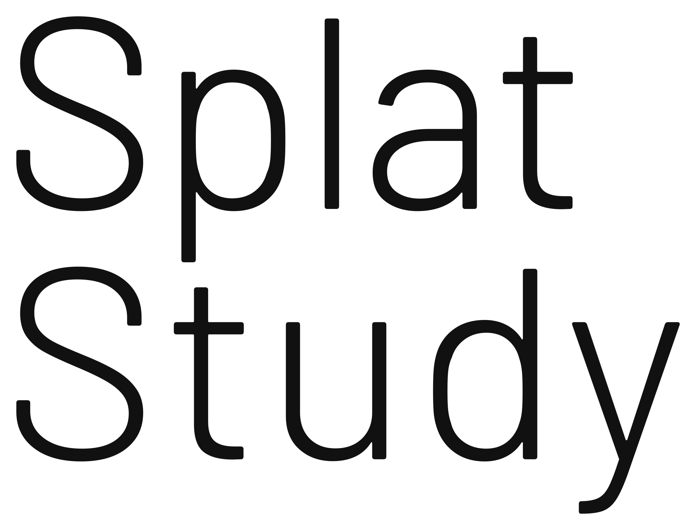

<h1>
  <picture>
    <source media="(prefers-color-scheme: dark)" srcset="web/logo/splatstudy-wordmark-white.svg">
    
  </picture>
</h1>

[日本語](README.md) | English

A digital sculpting tool for studying from a 3D reference.

The screen is split in two: your clay sculpt on the left, the reference on the right. Gaussian splats suit the reference best, but 3D scans, meshes and images work too.

In Japanese art-prep schools, students learn sculpture by modelling clay in front of plaster casts and live models. SplatStudy brings that way of learning to people who cannot attend such a school. It has aids for comparing your sculpt with the reference (linked cameras, silhouette comparison, a plumb line and more), and records the whole session as a timelapse.

> An entry in **Built with Claude: Japan 2026** (November 2 to 8, 2026). All the code was written during the event, with Claude Code. The look follows the author's own site, [thevirtualform.com](https://thevirtualform.com), but none of the site's code is used.

## Try it

In the browser: <https://app.splatstudy.com> (needs WebGPU: a recent Chrome or Edge, or Safari 26 and later)

Nothing to install. Drag and drop a file, or open one from the file menu.

Nine plaster cast scans are ready to study: pick one under **load from gallery** in the reference panel, or add one to the URL to open it as the reference:

- <https://app.splatstudy.com/?sample=brutus>: Brutus, after Michelangelo
- <https://app.splatstudy.com/?sample=venus>: Venus de Milo
- <https://app.splatstudy.com/?sample=david>: Head of David, after Michelangelo
- `homer`, `socrates`, `caesar`, `hercules` (head of the Farnese Hercules), `foot` (an athlete's right foot), `hands` (Abraham Lincoln's hands)

Eight were scanned by SMK, the National Gallery of Denmark, from its Royal Cast Collection ([open.smk.dk](https://open.smk.dk/)). Lincoln's hands come from the Smithsonian's National Portrait Gallery ([npg.si.edu](https://npg.si.edu/object/npg_S_NPG.71.6)). All nine are released under CC0 (public domain). The app shows their credit under the reference view and in exported images and videos.

## Features

### Sculpting

- Brushes: clay, smooth, move, flatten, inflate, crease, pinch. Hold Alt (ZBrush style) or Ctrl (Blender and Maya styles) for the opposite action, Shift to smooth
- Pen pressure for size and strength, a falloff slider from smooth to sharp, stroke stabiliser, X symmetry, undo and redo
- Clay with a fill mode that builds up hollows without raising their rims
- Masking: a mask tool, and in ZBrush style Ctrl paints the mask with any tool
- Multiresolution: subdivide, step between levels, and fix large forms while the detail is kept
- Voxel remesh and quad remesh (quads only, with a target quad count)
- Start from the reference (it is turned into solid clay, with a resolution and a smoothness setting), or import a mesh as the sculpt
- Mirror one side to the other, chalk (shows where you have worked), wireframe, smooth or flat shading
- Export as OBJ or STL

### References

- Gaussian splats: `.ply` (3DGS), `.splat`, `.spz`, with view-dependent colour (spherical harmonics)
- 3D scans and meshes: OBJ, PLY, STL (vertex colours)
- Images: PNG, JPEG (pan, zoom, double-click to fit)
- Centred and scaled automatically on load
- Alignment (up axis, rotation) and a crop box to cut away the floor and background
- Credit (title, author, licence, source), saved with the scene and included in exports

### Study aids

- Linked cameras: the sculpt and the reference move together. Preset viewpoints (front, sides, top and more), perspective or orthographic
- Silhouette: both views as flat shapes, with a match score (%) and a tint showing where the sculpt is too big or too small
- Ghost overlay of the reference on the sculpt
- Mirror view: flip the view horizontally to see familiar forms with fresh eyes
- Plumb line (drag its bob) and grid
- Proportion measure: draw a line in each view and compare their ratio
- Calipers: measure between two points, shown in both views and kept with the scene
- Pose timer (session length, rounds, pause)
- Lighting presets: studio, raking, top; a background colour for each view
- A toolbar click switches an aid in both views; Shift + click in that view only

### Timelapse

- Every brush stroke is recorded automatically and saved with the scene
- Replay in the app (×10, ×60, ×300, scrubber)
- Export as MP4 (WebCodecs in the browser; a zip of PNG images where WebCodecs is missing)
- Layouts: side by side, stacked, sculpt alone. Sizes: 16:9 (1080p), square 1:1, vertical 9:16
- Length (fit to 15, 30 or 60 s), camera (fixed or a slow turntable), a final turn, elapsed time and title overlays

### Files

- Save and open scenes (`.splatstudy`): the sculpt, its timelapse, the reference, alignment, cameras and study aid settings in one file. A smaller copy without the timelapse can be saved too
- Autosave in the browser (restored after a reload or a crash)
- Screenshot of both views side by side as a PNG

### Controls

- Navigation follows ZBrush, Blender or Maya style (navigation menu)
- Hold Space to set the brush size and strength at the pointer, Shift+Space for a pie menu of the tools; digit keys 1 to 8 pick a tool
- Tab hides the side panels, Shift+Tab the reference view too
- Every shortcut is listed in the app under **help › keyboard shortcuts**

The interface is in Japanese, English and French.

## Desktop app

Built on SDL3, with pen pressure. CI builds it for Windows (GitHub Actions artifacts); macOS and Linux can be built from source with the steps below.

The gallery casts are not inside the desktop app: the first time you open one, it is downloaded from app.splatstudy.com and kept in a cache folder (`%LOCALAPPDATA%\splatstudy\samples` on Windows, `~/Library/Caches/splatstudy/samples` on macOS, `$XDG_CACHE_HOME/splatstudy/samples` or `~/.cache/splatstudy/samples` on Linux). That is the only network request the app makes.

## Build

Needs Rust 1.90 or later and the `wasm32-unknown-unknown` target.

```
cargo test -p splatstudy-core
cargo xtask web          # browser build into dist/
cargo xtask serve        # http://127.0.0.1:8080
cargo run -p splatstudy-native --release   # desktop app (needs CMake)
```

- The desktop app builds SDL3 from source, so it needs CMake. On Windows, set the `CMAKE` environment variable to the `cmake.exe` that comes with Visual Studio.
- `cargo xtask web` also writes the licence notices (`licenses.html`), which needs [cargo-about](https://github.com/EmbarkStudios/cargo-about). If binaryen's [`wasm-opt`](https://github.com/WebAssembly/binaryen) is installed, it shrinks the wasm.

## Built with Claude Code

This repository was built with Claude Code from the first commit. One integrator session planned the work and merged it; agents in parallel git worktrees implemented features; review rounds checked the result.

- [`CLAUDE.md`](CLAUDE.md): instructions for Claude Code (hackathon rules, layout, conventions, definition of done)
- [`.claude/skills/verify-web`](.claude/skills/verify-web/SKILL.md): a skill that builds the browser version and checks it with a screenshot in headless Edge
- [`.claude/skills/add-ui-string`](.claude/skills/add-ui-string/SKILL.md): a skill that adds UI text in all three languages and rebuilds the Japanese font subset
- [`.claude/agents/licence-reviewer.md`](.claude/agents/licence-reviewer.md): an agent that checks REUSE headers and dependency licences
- [`.claude/hooks/guard-paths.sh`](.claude/hooks/guard-paths.sh): a hook that keeps Claude Code away from earlier prototypes during the hackathon
- [`.claude/hooks/check-spdx.sh`](.claude/hooks/check-spdx.sh): a hook that flags a Rust or WGSL file written without an SPDX header

## Licence

GPL-3.0-or-later ([`LICENSE`](LICENSE)) with an additional permission for app store distribution ([`LICENSE-EXCEPTION`](LICENSE-EXCEPTION)). The fonts (Barlow, Noto Sans JP) are under the SIL Open Font License, and the bundled plaster cast scans are CC0. Every file's licence is recorded in [REUSE](https://reuse.software/) format ([`LICENSES/`](LICENSES)). Every distributed build ships the third-party software and font notices as `licenses.html` (browser version: <https://app.splatstudy.com/licenses.html>).

Blender, Maya and ZBrush are trademarks of their respective owners, named only to describe the navigation styles.

See [`CONTRIBUTING.md`](CONTRIBUTING.md) to contribute and [`SECURITY.md`](SECURITY.md) to report a vulnerability.
