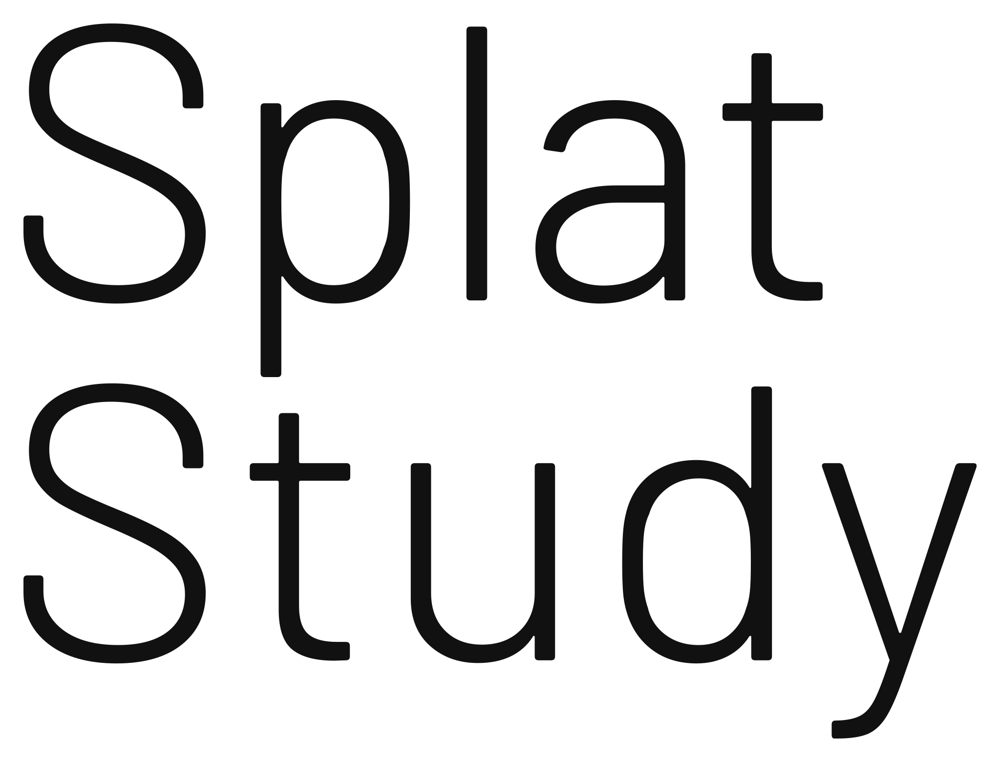

<h1>
  <picture>
    <source media="(prefers-color-scheme: dark)" srcset="web/logo/splatstudy-wordmark-white.svg">
    
  </picture>
</h1>

日本語 | [English](README.en.md)

3D の参照を横に置いて塑像する、デジタル彫刻ツール。

画面は左右に分かれています。左が自分の塑像、右がモチーフ（参照）です。モチーフにはガウシアンスプラットがいちばん向いていますが、3D スキャン、3D メッシュ、画像も使えます。

美術予備校では、石膏像や人物モデルを前にして粘土で塑像を学びます。SplatStudy は、その学び方を予備校に通えない人にも届けるためのツールです。モチーフと見比べるための道具（視点の連動、シルエット比較、鉛直線など）がそろっていて、制作の過程はタイムラプスとして残ります。

> **Built with Claude: Japan 2026** の参加作品です（2026年11月2日〜8日）。コードはすべてこの期間に Claude Code と書いています。見た目は作者自身のサイト [thevirtualform.com](https://thevirtualform.com) に合わせていますが、サイトのコードは使っていません。

## 使う

ブラウザ版：<https://app.splatstudy.com>（WebGPU が必要です。Chrome / Edge の最新版、Safari 26 以降）

インストールは要りません。ファイルをドラッグ＆ドロップするか、ファイルメニューから開きます。

すぐに試せるように、石膏像のスキャンを 3 つ同梱しています。URL の最後に付けると、モチーフとして開きます。

- <https://app.splatstudy.com/?sample=brutus>：ブルータス（ミケランジェロによる）
- <https://app.splatstudy.com/?sample=venus>：ミロのヴィーナス
- <https://app.splatstudy.com/?sample=david>：ダビデの頭部（ミケランジェロによる）

3 つとも、デンマーク国立美術館（SMK）の Royal Cast Collection がスキャンし、CC0（パブリックドメイン）で公開しているものです（[open.smk.dk](https://open.smk.dk/)）。アプリの中でも、モチーフの下と書き出した画像・動画にクレジットが表示されます。

## できること

### 塑像

- ブラシ：クレイ、スムーズ、ムーブ、フラッテン、インフレート、クリース、ピンチ。押している間は逆の動き（ZBrush 風は Alt、Blender・Maya 風は Ctrl）、Shift でスムーズ
- 筆圧で大きさと強さ、減衰カーブ、手ぶれ補正、左右対称、元に戻す・やり直す
- マスク：マスクツールのほか、ZBrush 風の操作ではどのツールでも Ctrl で塗れます
- 多重解像度：細分化してレベルを上げ下げし、細部を残したまま大きな形を直せます
- ボクセルリメッシュ、クアッドリメッシュ（クアッドのみ、クアッド数を指定）
- モチーフから塑像を始める（モチーフをボクセル化して粘土にします）、メッシュを塑像として読み込む
- 左右を写す、チョーク（触ったところがわかる）、ワイヤーフレーム
- OBJ・STL で書き出し

### モチーフ

- ガウシアンスプラット：`.ply`（3DGS）、`.splat`、`.spz`。見る向きで変わる色（球面調和関数）にも対応
- 3D スキャン・メッシュ：OBJ、PLY、STL（頂点カラー）
- 画像：PNG、JPEG（移動・拡大、ダブルクリックで全体を表示）
- 読み込むと自動で中央に置き、大きさをそろえます
- 位置合わせ（上方向、回転）、切り抜き枠（床や背景を切り落とす）
- クレジット（作品名、作者、ライセンス、出典）。シーンと一緒に保存され、書き出しにも入ります

### 学ぶための道具

- 視点の連動：塑像とモチーフが同じ視点で動きます。正面・側面・上面などの決まった視点、パース表示と平行投影
- シルエット：両方を平らな影として表示。一致率（%）と、はみ出し・足りない部分の色分け
- モチーフを重ねる（ゴースト表示）
- 左右反転表示：見慣れた形を新しい目で見直せます
- 垂直線（おもりをドラッグして動かす）とグリッド
- 比率を測る：それぞれのビューに線を引き、モチーフとの比率を比べます
- ポーズタイマー（時間、回数、一時停止）
- ライト：スタジオ、斜光、天窓
- 道具はビューごとに切り替えられます。Shift＋クリックで両方のビューに

### タイムラプス

- ブラシの動きをすべて自動で記録し、シーンと一緒に保存します
- アプリの中で再生（×10・×60・×300、シークバー）
- MP4 で書き出し（ブラウザ版は WebCodecs。使えないブラウザーでは PNG 画像の ZIP）
- レイアウト：左右、上下、塑像のみ。画面：横 16:9（1080p）、正方形 1:1、縦 9:16
- 長さ（15・30・60 秒に合わせる）、カメラ（固定・ゆっくり回る）、最後に一周、経過時間とタイトルの表示

### ファイル

- シーン（`.splatstudy`）の保存と読み込み：塑像、タイムラプス、モチーフ、位置合わせ、カメラ、学ぶための道具の設定をまとめて保存します。タイムラプスなしの小さなコピーも保存できます
- ブラウザ版は自動保存します（再読み込みやクラッシュのあとに復元）
- スクリーンショット：両方のビューを並べて PNG に

### 操作

- 視点操作は ZBrush 風・Blender 風・Maya 風から選べます（「視点操作」メニュー）
- Space を押したままでツールのパイメニュー、数字キー 1〜8 でツールを選択
- Tab でパネルを隠す、Shift+Tab でモチーフのビューも隠す
- すべてのショートカットは、アプリの **ヘルプ › キーボードショートカット** にあります

表示言語は日本語・英語・フランス語です。

## デスクトップ版

SDL3 を使い、ペンの筆圧に対応しています。今は CI で Windows 版だけをビルドしています（GitHub Actions の成果物）。リポジトリが非公開のあいだは、macOS と Linux の CI を止めています。どちらも下の手順でソースからビルドできます。

## ビルド

Rust 1.90 以降と `wasm32-unknown-unknown` ターゲットが必要です。

```
cargo test -p splatstudy-core
cargo xtask web          # dist/ にブラウザ版
cargo xtask serve        # http://127.0.0.1:8080
cargo run -p splatstudy-native --release   # デスクトップ版（CMake が必要）
```

- デスクトップ版は SDL3 をソースからビルドするため CMake が必要です。Windows では、環境変数 `CMAKE` に Visual Studio 付属の `cmake.exe` を指定してください。
- `cargo xtask web` はライセンス表示（`licenses.html`）も作るため、[cargo-about](https://github.com/EmbarkStudios/cargo-about) が必要です。[binaryen](https://github.com/WebAssembly/binaryen) の `wasm-opt` があれば、wasm を小さくします。

## Claude Code で作りました

このリポジトリは、最初から Claude Code と一緒に作っています。統合を担当する 1 つのセッションが計画とマージを受け持ち、機能ごとに git worktree で並行して動くエージェントが実装し、そのあとレビューのラウンドで確認する、という進め方でした。

- [`CLAUDE.md`](CLAUDE.md)：Claude Code への指示（ハッカソンのルール、構成、規約、完了の定義）
- [`.claude/skills/verify-web`](.claude/skills/verify-web/SKILL.md)：ブラウザ版をビルドし、ヘッドレスの Edge でスクリーンショットを撮って確認するスキル
- [`.claude/skills/add-ui-string`](.claude/skills/add-ui-string/SKILL.md)：UI の文字列を 3 言語で追加し、日本語フォントのサブセットを作り直すスキル
- [`.claude/agents/licence-reviewer.md`](.claude/agents/licence-reviewer.md)：REUSE ヘッダーと依存クレートのライセンスを確認するエージェント
- [`.claude/hooks/guard-paths.sh`](.claude/hooks/guard-paths.sh)：ハッカソン中に過去のプロトタイプを開かないようにするフック
- [`.claude/hooks/check-spdx.sh`](.claude/hooks/check-spdx.sh)：書いた Rust・WGSL ファイルに SPDX ヘッダーがないと知らせるフック

## ライセンス

GPL-3.0-or-later（[`LICENSE`](LICENSE)）に、アプリストアで配布するための追加許可（[`LICENSE-EXCEPTION`](LICENSE-EXCEPTION)）を付けています。フォント（Barlow、Noto Sans JP）は SIL Open Font License、同梱の石膏像のスキャンは CC0 です。すべてのファイルのライセンスは [REUSE](https://reuse.software/) 形式で書かれています（[`LICENSES/`](LICENSES)）。使っている第三者のソフトウェアとフォントのライセンス表示は、配布するすべてのビルドに `licenses.html` として付けています（ブラウザ版：<https://app.splatstudy.com/licenses.html>）。

Blender、Maya、ZBrush はそれぞれの権利者の商標で、操作方法の説明のためにだけ名前を挙げています。

参加のしかたは [`CONTRIBUTING.md`](CONTRIBUTING.md)、脆弱性の報告は [`SECURITY.md`](SECURITY.md) を見てください。
